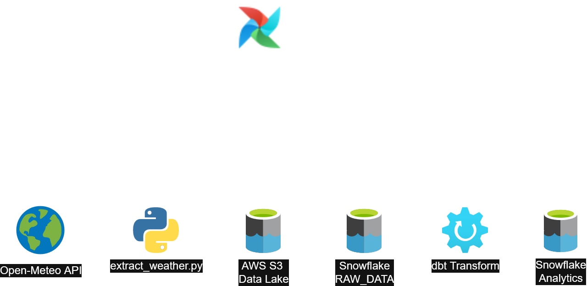

# 🌦️ Winnipeg Weather Data Pipeline

An automated, end-to-end cloud data pipeline that extracts daily weather forecast data, loads it into a cloud data lake, and transforms it into an analytics-ready format using the Modern Data Stack.

## 🏗️ Architecture


## 💡 Business Value
Manual data collection for local weather and transit correlations is time-consuming and error-prone. This pipeline automates the daily ingestion of Winnipeg weather data, ensuring data engineers and analysts have reliable, tested, and structured data available in the data warehouse every morning without manual intervention.

## 🛠️ Tech Stack
- **Extraction**: Python (`requests`, `logging`)
- **Data Lake**: AWS S3
- **Data Warehouse**: Snowflake
- **Transformation & Testing**: dbt (data build tool)
- **Orchestration**: Apache Airflow (Docker)
- **Version Control**: Git & GitHub

## 📂 Project Structure
```text
.
├── dags/
│   └── weather_pipeline_dag.py      # Airflow DAG orchestrating the pipeline
├── models/                          # dbt SQL models and schema tests
├── extract_weather.py               # Python script to fetch API data
├── load_to_s3.py                    # Python script to upload to AWS S3
├── docker-compose.yaml              # Local Airflow environment setup
└── .env                             # Environment variables (git-ignored)
